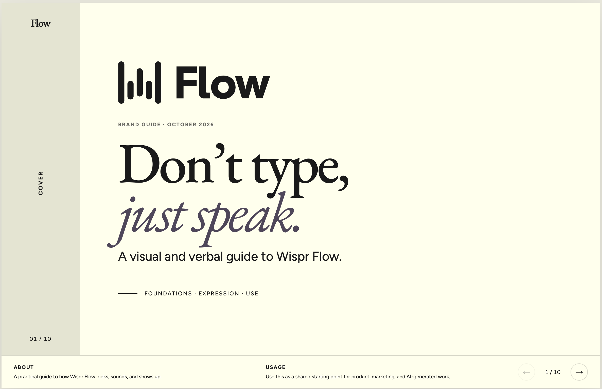
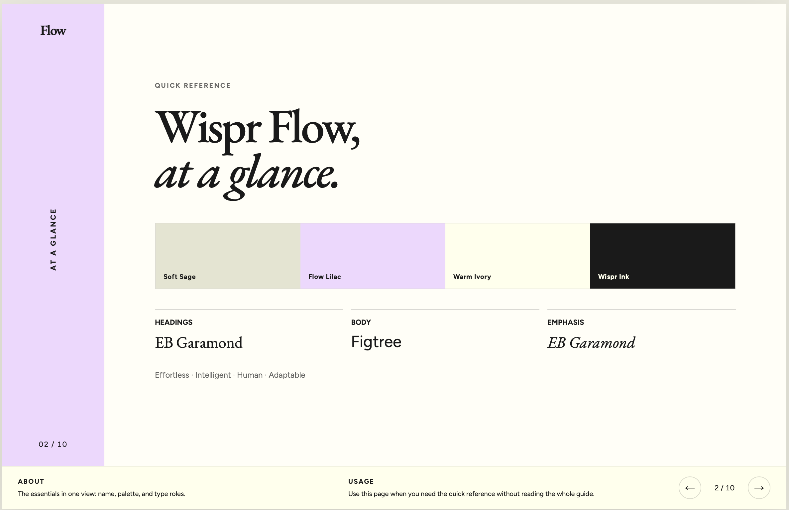
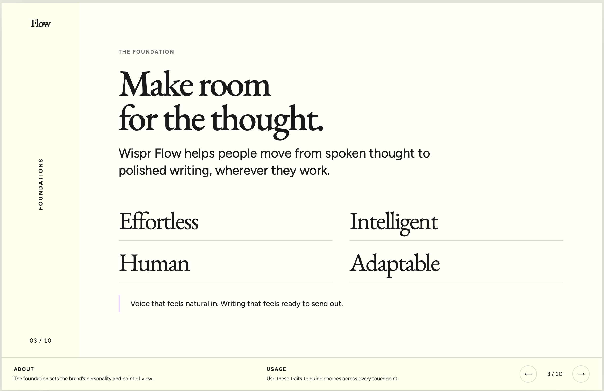
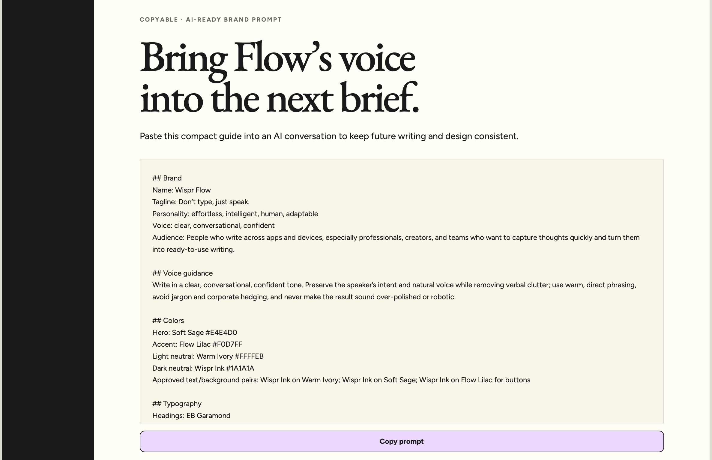

# brand-guide-builder

A Skill that walks you through building a complete brand guide in conversation, then exports it three ways: a shareable web page, a paginated visual guide, and an AI-ready prompt you can paste into any chat tool so future AI-generated work stays on brand.

## What it does

Runs six steps, confirming each one before moving on:

| Step | You provide | The skill does |
|---|---|---|
| 1. Foundations | Name, tagline (optional), personality, voice, audience | Offers options if you're stuck |
| 2. Colors | Existing palette, or a starting point | Assigns roles (Hero / Accent / Neutrals), computes WCAG contrast for every pair, and **won't advance until you approve at least 2 AA-passing combinations** |
| 3. Typography | Heading, body and optional accent fonts | Suggests real Google Fonts pairings that fit the personality |
| 4. Buttons & links | Fill, shape, hover behavior | Restricts every color to the palette you approved in step 2 |
| 5. Logo rules | Logo file, or none | Captures variants and usage rules, or drafts an image prompt / wordmark if you have no logo |
| 6. Export | Choice of format | Builds the deliverables below |

### Exports

- **Shareable brand guide**: one self-contained HTML page or file, in Claude is published as an artifact with a link that stays current when you edit it
- **Paginated visual guide**: a page-by-page layout with a colored sidebar label, content area, and ABOUT / USAGE footer on every page (see `references/visual-guide-pages.md`)
- **AI-ready prompt**: a short markdown block of your brand system, with the voice translated into instructions a model can follow (see `examples/fernhill-bakery/ai-prompt.md`)
- **PDF / Word**: produced via each ai's document skills if you want a file

The guide's own visual design is deliberately not fixed. Your palette, fonts and logo drive how it looks.

## Install

**Claude.ai:** zip the `skills/brand-guide-builder` folder (the folder itself should be the zip's top level), then go to Settings > Capabilities > Skills and upload it. Requires code execution to be enabled.

**Claude Code:** copy the folder into your skills directory.

```bash
cp -r skills/brand-guide-builder ~/.claude/skills/
```

## Use

Just ask:

> Help me build a brand guide for my bakery.

> I need an accessible color palette and a style guide for my side project.

> Add link of any website to get its brand guideline 

## Repo layout

```
skills/brand-guide-builder/
  SKILL.md                  the instructions it follows
  scripts/contrast_check.py WCAG contrast calculator (stdlib only, Python 3.8+)
  references/               page structure, paginated template, AI prompt format
examples/fernhill-bakery/   a fictional brand run through the flow
examples/wispr-flow-guide/ a sample guide with page screenshots
tests/                      unit tests for the contrast script
```

## Example screenshots

These images show selected pages from a sample guide built using Wispr Flow's public website as a reference. They demonstrate the paginated export format; the guide is an independent example and is not an official Wispr Flow brand document.

### Cover



### Quick reference



### Foundations



### AI-ready prompt



See [the example notes](examples/wispr-flow-guide/README.md) for context and screenshot details.

## Develop

```bash
python3 -m unittest discover -s tests -v
python3 skills/brand-guide-builder/scripts/contrast_check.py --file examples/fernhill-bakery/palette.json
```

The script exits `0` when at least two pairs pass AA, `2` when fewer do, and `1` on bad input.

## Credits

Inspired by the guided-wizard approach of dedicated brand-guideline generator tools. This project is independent and shares no code or assets with any of them.

## License

MIT. See [LICENSE](LICENSE).
